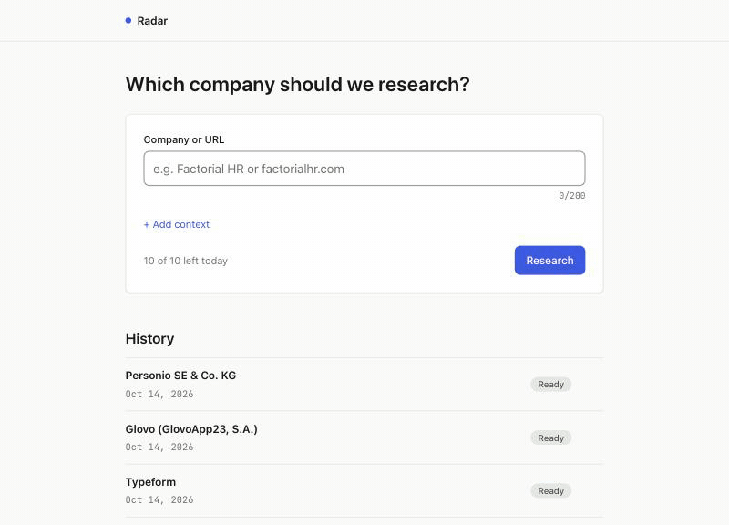

# Radar — company research agent

[](https://github.com/marioarranzr/radar/actions/workflows/ci.yml)

> **Built with agent automation, end to end:** an AI agent does the research inside the product,
> and AI coding agents wrote the code — directed through specs, a step-by-step plan and review
> agents. [How and why ↓](#agent-automation-twice)

Type a company name; an AI agent searches the web, reads the relevant pages and hands you a
**one-page brief with cited sources** in about a minute: what they sell and to whom, business
model, key facts, recent signals, likely pains and questions for a first call.

<p align="center">
  
</p>

## Agent automation, twice

**1. In the product — an agent, not a chatbot.**
Preparing for a sales call means 20–40 minutes of tabs: website, news, funding, job posts.
A chat assistant helps, but only if you know what to ask, the format changes every time and
nothing is kept. Radar sits in the layer between the model and the user: the user types a name,
and the product owns everything else.

- **The model decides the path.** Which searches to run, which pages to open, when it has enough —
  that's open-ended, multi-step work a fixed pipeline can't anticipate. That's why it's an agent.
- **The code owns the guardrails.** A strict output schema, validation with one self-correction
  turn, a reminder if the model stops early, capped turns, a daily budget, readable failures and a
  retry. The model is creative; the system around it is deterministic.
- **It's measured, not demoed.** An evaluation script runs it on real companies and tracks
  success rate, latency, sources and cost per brief ([results](docs/eval-results.md)):
  10/10 valid briefs, median 70 s.

**2. In how it was built — AI coding agents, directed like a team.**
The code was written by AI coding agents (Claude Code); my job was the part that doesn't
automate: deciding what to build and holding the work to a standard.

- **Specs before code.** Six documents — product, technical, flow, design, data, plan — define
  the work, and a [CLAUDE.md](CLAUDE.md) tells the agents how to use them.
- **One plan step, one commit.** The history reads like the plan, and every decision that changed
  (switching LLM provider, dropping a database service) is recorded in the
  [decision log](docs/02-TRD.md#9-decision-log-lightweight-adr) before the code changed.
- **Specialised reviewers.** Database, code, security, React and accessibility review agents
  checked every phase; their real findings (a dev server exposed to the LAN, a DST bug in the
  daily limit, contrast failures) were fixed and are explained in the commit messages.
- **Tests as the safety net.** 180 tests, including the agent loop driven by a scripted fake model,
  so behaviour is verified without paying for API calls.

The result doubles as a **reusable template** for building software with AI agents — see
[Built document-first](#built-document-first).

## How the agent works

```
 "Factorial HR" ─▶ POST /api/research ─▶ row in SQLite (queued) ─▶ responds with the id
                                   │
                                   └─ after the response: run queue (2 agents at a time)
                                           │
                   ┌───────────────────────▼───────────────────────┐
                   │ Researcher · OpenAI Responses API (gpt-6.1-sol) │◀─┐ chained with
                   │  web_search            (OpenAI-hosted)          │  │ previous_response_id
                   │  lookup_company_facts  (our server → Wikidata)  │  │
                   │  submit_report         (strict JSON schema)     │  │
                   └───────────────────────┬───────────────────────┘  │
           each finished tool call ─▶ progress step in SQLite          │
           no brief yet? ─▶ one reminder ──────────────────────────────┤
           invalid brief? ─▶ Zod errors sent back once ─────────────────┘
           valid brief ─▶ (optional) verifier agent re-checks it ─▶ saved

 Browser polls GET /api/research/[id] every 2 s ─▶ live steps, then the brief
 Evaluation only: a judge agent opens the cited pages and scores each brief
```

- The user never writes a prompt: all the "how to ask the model" lives in the product.
- Three agents share **one loop** (researcher, verifier, judge): tools, strict submission,
  one reminder, one self-correction, turn caps, refusal and truncation handling.
- Failures (refusals, truncation, bad keys, rate limits) end in a readable error with a Retry button.

## What it does

- **Research one company or many** — type a name, or paste / upload a CSV of up to 20.
- **Watch it work** — live steps: searches, pages read, Wikidata lookups.
- **A one-page brief** — summary, offering, business model, key facts (unconfirmed ones flagged),
  dated recent signals, likely pains, questions for a first call, and every source.
- **Follow companies** — refreshed every 7 days while Radar runs; signals that weren't in the
  previous brief are badged **New**.
- **Export** — copy or download as Markdown, or print to PDF.

## Getting started

Requirements: **Node 24+** (for the built-in `node:sqlite`) and an **OpenAI API key**.

```bash
git clone https://github.com/marioarranzr/radar.git
cd radar
npm install
cp .env.example .env.local   # then set OPENAI_API_KEY
npm run dev                  # http://127.0.0.1:3000
```

| Command | What it does |
|---|---|
| `npm run dev` | Local server, bound to 127.0.0.1 only |
| `npm test` | Unit, route and component tests (Vitest), no network |
| `npm run lint` | ESLint + route type generation + `tsc` |
| `npm run agent:try -- "Company" ["context"]` | Run the agent from the terminal and print the brief |
| `npm run agent:eval` | Research and judge the 10 evaluation companies; print a results table |
| `npm run agent:judge` | Judge the latest stored brief of each evaluation company (no new research) |
| `npm run agent:verify-eval` | Run the verifier on the stored briefs and report what it changes |

Data lives in a single local file, `data/radar.db` (ignored by git).

## Stack

Next.js 15 (App Router) · TypeScript · Tailwind CSS 4 · SQLite via Node's built-in `node:sqlite` ·
OpenAI Responses API · Zod 4 · Vitest + Testing Library. Five runtime dependencies, no external
services besides OpenAI, no component or icon library.

## Project structure

```
docs/            The specs that drive development (see below)
src/agent/       Agents: shared loop, researcher, verifier, run queue, watchlist, Wikidata tool
src/eval/        Evaluation: LLM judge, results table, evaluation set
src/app/         Pages and API routes (Next.js App Router)
src/components/  Hand-written UI components
src/lib/         SQLite store, env validation, request validation, formatting
src/middleware.ts  Localhost-only guard (DNS rebinding + CSRF)
scripts/         Terminal tools: try the agent, evaluate it, judge it, measure the verifier
tests/           180 tests: agents driven by a scripted fake model, recorded Wikidata responses
```

## Built document-first

Every feature was specified before it was coded. AI coding agents read these in order
(enforced by [CLAUDE.md](CLAUDE.md)) and work one plan step at a time, one commit per step:

| Doc | Answers |
|---|---|
| [01-PRD](docs/01-PRD.md) | What and why — exact scope and what is *not* included |
| [02-TRD](docs/02-TRD.md) | With what — stack, agent configuration, APIs and a decision log |
| [03-APP-FLOW](docs/03-APP-FLOW.md) | How it is navigated — every button and what happens next |
| [04-DESIGN-BRIEF](docs/04-DESIGN-BRIEF.md) | How it looks — tokens, typography, components, screens |
| [05-BACKEND-SCHEMA](docs/05-BACKEND-SCHEMA.md) | Where data lives — tables, columns, lifecycle |
| [06-IMPLEMENTATION-PLAN](docs/06-IMPLEMENTATION-PLAN.md) | In what order — steps with a "done" criterion |

**Use it as a template:** copy `CLAUDE.md` and `docs/`, rewrite the docs in order (01 → 06),
then ask your agent to list contradictions between them before writing any code.

## Evaluation

Every change to the agent is measured on the same ten companies with `npm run agent:eval`, and a
**judge agent** opens the cited pages to check the five most important claims of each brief.
Full tables in [docs/eval-results.md](docs/eval-results.md).

| Experiment | Result | Decision |
|---|---|---|
| Baseline (`gpt-6.1-sol`) | 10/10 briefs, 50/50 checked claims supported | — |
| Less web content per search (`low`) | Cost −18 % ($0.138), time −40 % (42 s), quality within noise | **Default** |
| Verifier agent (second agent re-checks facts) | +39 % cost, +16 s, no real error caught | **Opt-in only** |
| Cheaper model (`gpt-6-luna`) | $0.038, but relevance 3.4/5 and 90 % claims supported | Not adopted |
| Stronger model (`gpt-6-astra`) | $0.66 for a small quality gain | Not adopted |

Adding an agent is easy; knowing when it's worth it is the job.

## Engineering notes

A few things that weren't obvious:

- **Strict schemas have limits.** Strict function calling rejects keywords like `minItems` or
  `maxLength`, so they are stripped from the schema sent to the model and enforced by Zod instead.
- **SDK helpers can be wrong.** The OpenAI SDK's streaming helper threw on a valid sequence of
  output items, so the agent reads the raw server events and takes the final response from the
  terminal event ([openai-stream.ts](src/agent/openai-stream.ts)).
- **Models leak internals.** Web search answers can contain private-use citation markers; they're
  stripped before validation ([sanitize.ts](src/agent/sanitize.ts)).
- **"Local only" needs enforcing.** `next dev` listens on every interface by default; Radar binds to
  127.0.0.1 and a middleware rejects non-local hosts and cross-site writes.
- **Real APIs differ from their types.** The live API returned a web search item without the
  `action` the SDK types promise; it only showed up in an evaluation run, and progress reporting can
  no longer fail a research.
- **Tool outputs steer behaviour.** The agent used Wikidata's facts without citing them until the
  tool's output itself carried a ready-made sources entry.
- **Web content is untrusted input.** The brief is rendered as plain text, links are restricted to
  http(s) and open with `noopener noreferrer`, and the user's own text is escaped inside the prompt.

## License

[MIT](LICENSE)
