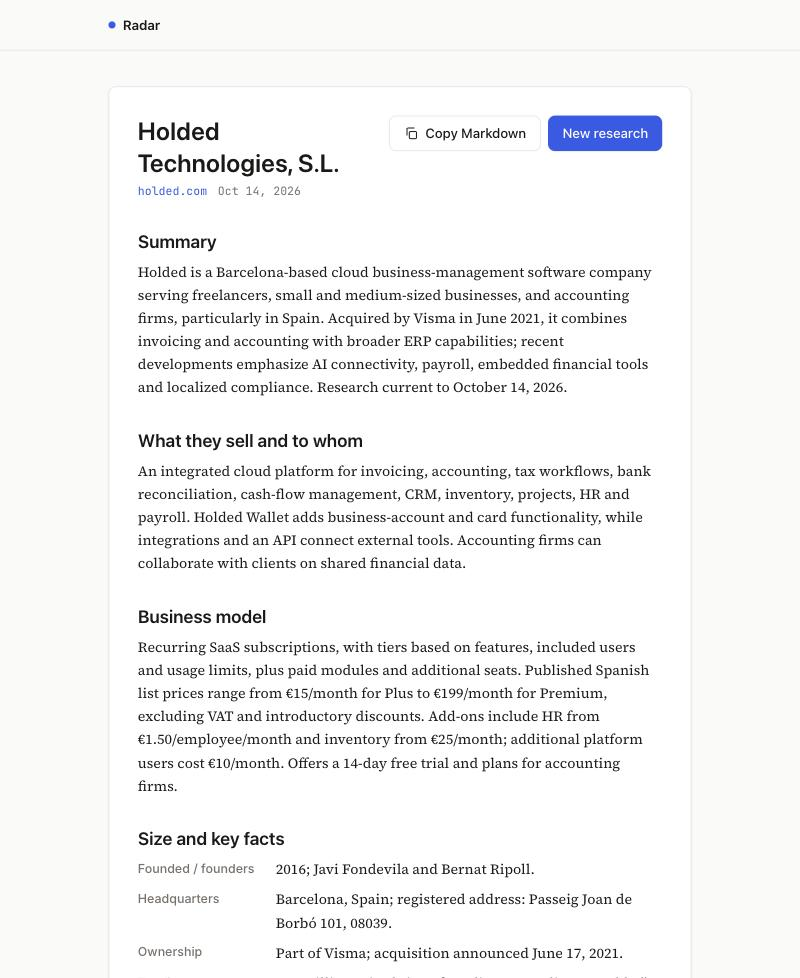

# Radar — company research agent

Type a company name; an AI agent searches the web, reads the relevant pages and hands you a
**one-page brief with cited sources** in about a minute: what they sell and to whom, business
model, key facts, recent signals, likely pains and questions for a first call.

It's a small, local, single-user tool built to learn agent automation end to end — and a
**documentation-first template** for building software with AI coding agents.

<p align="center">
  
</p>

## How the agent works

```
 "Factorial HR"  ──▶  POST /api/research ──▶ row in SQLite (queued) ──▶ responds with the id
                                     │
                                     └─ after the response: runResearchAgent(id)
                                           │
                     ┌─────────────────────▼─────────────────────┐
                     │  OpenAI Responses API (gpt-6.1-sol)        │
                     │  tools: web_search (search / open pages)   │◀─┐ chained with
                     │         submit_report (strict JSON schema) │  │ previous_response_id
                     └─────────────────────┬─────────────────────┘  │
             each finished tool call ──▶ progress step in SQLite     │
             no brief yet? ──▶ one reminder ─────────────────────────┤
             invalid brief? ──▶ errors sent back once ───────────────┘
             valid brief ──▶ validated with Zod ──▶ saved (done)

 Browser polls GET /api/research/[id] every 2 s ──▶ live steps, then the brief
```

- The user never writes a prompt: all the "how to ask the model" lives in the product.
- The brief is a **strict function call** validated again with Zod — no free-text parsing.
- Failures (refusals, truncation, bad keys, rate limits) end in a readable error with a Retry button.

## Getting started

Requirements: **Node 24+** (for the built-in `node:sqlite`) and an **OpenAI API key**.

```bash
git clone https://github.com/marioarranzr/radar.git
cd radar
npm install
cp .env.example .env.local   # then set OPENAI_API_KEY
npm run dev                  # http://127.0.0.1:3000
```

| Command | What it does |
|---|---|
| `npm run dev` | Local server, bound to 127.0.0.1 only |
| `npm test` | Unit, route and component tests (Vitest), no network |
| `npm run lint` | ESLint + route type generation + `tsc` |
| `npm run agent:try -- "Company" ["context"]` | Run the agent from the terminal and print the brief |
| `npm run agent:eval` | Run the agent on 10 companies and print a results table |

Data lives in a single local file, `data/radar.db` (ignored by git).

## Stack

Next.js 15 (App Router) · TypeScript · Tailwind CSS 4 · SQLite via Node's built-in `node:sqlite` ·
OpenAI Responses API · Zod 4 · Vitest + Testing Library. Five runtime dependencies, no external
services besides OpenAI, no component or icon library.

## Project structure

```
docs/            The specs that drive development (see below)
src/agent/       The agent: prompt, brief schema, loop, progress steps, stream adapter
src/app/         Pages and API routes (Next.js App Router)
src/components/  Hand-written UI components
src/lib/         SQLite store, env validation, request validation, formatting
src/middleware.ts  Localhost-only guard (DNS rebinding + CSRF)
scripts/         Terminal tools: try the agent, evaluate it
tests/           107 tests, including the agent loop driven by a scripted fake model
```

## Built document-first

Every feature was specified before it was coded. AI coding agents read these in order
(enforced by [CLAUDE.md](CLAUDE.md)) and work one plan step at a time, one commit per step:

| Doc | Answers |
|---|---|
| [01-PRD](docs/01-PRD.md) | What and why — exact scope and what is *not* included |
| [02-TRD](docs/02-TRD.md) | With what — stack, agent configuration, APIs and a decision log |
| [03-APP-FLOW](docs/03-APP-FLOW.md) | How it is navigated — every button and what happens next |
| [04-DESIGN-BRIEF](docs/04-DESIGN-BRIEF.md) | How it looks — tokens, typography, components, screens |
| [05-BACKEND-SCHEMA](docs/05-BACKEND-SCHEMA.md) | Where data lives — tables, columns, lifecycle |
| [06-IMPLEMENTATION-PLAN](docs/06-IMPLEMENTATION-PLAN.md) | In what order — steps with a "done" criterion |

Each phase was also reviewed by specialised review agents (database, code, security, React,
accessibility) before committing. Their findings — and the fixes — are in the commit messages.

**Use it as a template:** copy `CLAUDE.md` and `docs/`, rewrite the docs in order (01 → 06),
then ask your agent to list contradictions between them before writing any code.

## Evaluation

Ten companies, run with `npm run agent:eval` — see [docs/eval-results.md](docs/eval-results.md).

## Engineering notes

A few things that weren't obvious:

- **Strict schemas have limits.** Strict function calling rejects keywords like `minItems` or
  `maxLength`, so they are stripped from the schema sent to the model and enforced by Zod instead.
- **SDK helpers can be wrong.** The OpenAI SDK's streaming helper threw on a valid sequence of
  output items, so the agent reads the raw server events and takes the final response from the
  terminal event ([openai-stream.ts](src/agent/openai-stream.ts)).
- **Models leak internals.** Web search answers can contain private-use citation markers; they're
  stripped before validation ([sanitize.ts](src/agent/sanitize.ts)).
- **"Local only" needs enforcing.** `next dev` listens on every interface by default; Radar binds to
  127.0.0.1 and a middleware rejects non-local hosts and cross-site writes.
- **Web content is untrusted input.** The brief is rendered as plain text, links are restricted to
  http(s) and open with `noopener noreferrer`, and the user's own text is escaped inside the prompt.

## License

[MIT](LICENSE)
